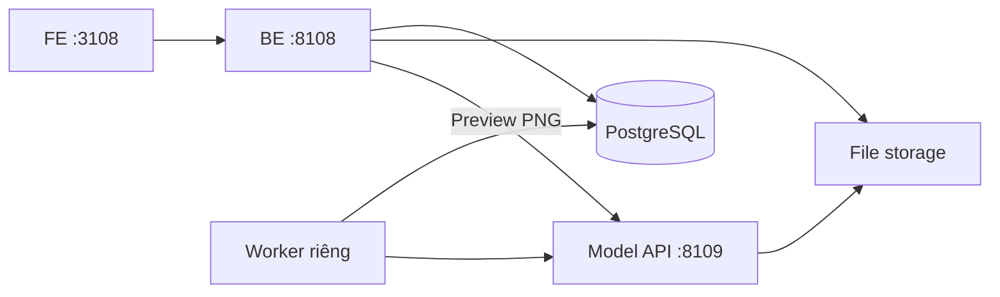

# Demo CT → PET Điện Biên

Giao diện tiếng Việt, chữ lớn, thao tác theo ba bước: tải ZIP CT → chờ mô hình → xem CT/PET và tải PET. Hiện bật RegGAN baseline đã có trong workspace; có thể thay checkpoint hoặc thêm kiến trúc model sau.

## Địa chỉ trên máy chủ hiện tại

**Web public có kết nối model thật:** https://dienbien-ct-pet-421a3d73.vercel.app

Frontend chạy trên Vercel, gọi backend qua Cloudflare HTTPS. **Không cần nhập tài khoản hoặc mật khẩu**: trình duyệt tự nhận phiên để tải CT và xem PET của các ca do phiên đó tạo. Backend hiện dùng Quick Tunnel tạm thời; URL API được ghi trong `artifacts/public-preview.json`. Link backend thay đổi khi tạo lại tunnel; frontend Vercel giữ nguyên URL và cần redeploy với địa chỉ API mới. Chưa phải cấu hình backend domain cố định.

| Dịch vụ | Địa chỉ | Công nghệ |
|---|---|---|
| Giao diện | http://192.168.1.17:3108 hoặc http://localhost:3108 | React, TypeScript, Vite |
| Backend | http://localhost:8108/docs | FastAPI, SQLAlchemy |
| Model API | http://localhost:8109/docs | FastAPI, PyTorch; chỉ bind loopback khi chạy local |
| Database | localhost:55432 | PostgreSQL 16; chỉ bind loopback |

Các cổng 3000/8000/8001/5433 đã có dịch vụ khác dùng nên demo có cổng riêng. Subnet Docker riêng `10.253.108.0/24` tránh pool mặc định đã đầy trên máy chủ.



Backend không nạp checkpoint hoặc import PyTorch. Worker nhận job từ PostgreSQL, gọi Model API, cập nhật tiến độ. Model API xử lý I/O CT, inference, preview và xuất NIfTI. File lớn lưu trên ổ đĩa; PostgreSQL lưu trạng thái, model version và metadata.

## Các chức năng đã có

- Tải bằng nút hoặc kéo thả ZIP DICOM/NIfTI; tiến độ upload và inference là tiến độ thật.
- Nhận ZIP DICOM nhiều series, cho chọn series CT và bỏ qua ảnh phụ/PET; giữ trạng thái chọn khi tải lại trang.
- Preview đồng thời Axial, Coronal, Sagittal: mỗi hướng có cặp CT/PET và một thanh chọn lát cắt đồng bộ.
- Cửa sổ CT mô mềm/phổi/xương; thang PET có thể đổi.
- Tải ZIP PET gồm `predicted_pet.nii.gz` và `metadata.json`.
- Khôi phục lượt chạy khi tải lại trang; URL `/?job=<uuid>` mở lại một kết quả.
- Thông báo lỗi tiếng Việt cho ZIP hỏng, CT không hợp lệ, mất kết nối và model chưa sẵn sàng.
- Hàng đợi PostgreSQL có lease, `FOR UPDATE SKIP LOCKED` và giới hạn retry. Nếu worker bị ngắt, job được nhận lại khi lease hết hạn. Model API xử lý yêu cầu cùng job ID theo kiểu idempotent; kết quả đã xong không chạy inference lại.
- Checkpoint fingerprint được gắn vào từng job. Job không âm thầm đổi model khi checkpoint được thay.

## Chạy và dừng trên workspace này

Demo hiện dùng PostgreSQL trong Docker, các dịch vụ ứng dụng trong tmux; môi trường Python riêng `.venv` dùng lại các thư viện model đã có để tránh cài PyTorch/CUDA lần nữa.

```bash
cd /mnt/disk1/aiotlab/quanghv/dienbien_pet_demo
bash scripts/run-local.sh
```

Nếu vừa sửa giao diện hoặc cổng backend:

```bash
.venv/bin/python scripts/build-web.py
```

Dừng ứng dụng, giữ database và các file:

```bash
bash scripts/stop-local.sh
docker compose stop db
```

Các phiên chạy có tiền tố `dienbien_pet_demo_`. Log ở `logs/backend.log`, `logs/model.log`, `logs/worker.log`, `logs/frontend.log`.

Khởi tạo môi trường local lại nếu cần (Python model phải có PyTorch, numpy, scipy, nibabel, SimpleITK, pydicom và Pillow):

```bash
MODEL_PYTHON=/mnt/disk1/aiotlab/quanghv/.venvs/roi-totalsegmentator/bin/python \
  bash scripts/setup-local.sh
bash scripts/run-local.sh
```

Script tạo `.env` với mật khẩu PostgreSQL ngẫu nhiên khi chưa có file; không ghi đè cấu hình đang dùng. `.env`, dữ liệu và virtualenv không được đưa vào source control. Dependencies frontend có `package-lock.json`; backend có `requirements.lock.txt`.

## Thay hoặc bổ sung model

Baseline hiện tại:

```text
/mnt/disk1/aiotlab/quanghv/gan_offset_zoom_new/scaleB_best91_organW1_two_alpha_20261008_200124_new/alpha_0.01/best.pt
```

Với checkpoint cùng kiến trúc RegGAN, sửa `.env`:

```dotenv
MODEL_CHECKPOINT=/duong/dan/checkpoint_moi.pt
MODEL_LABEL=Ten phien ban moi
MODEL_DEVICE=cuda:0
CUDA_VISIBLE_DEVICES=1
```

`cuda:0` là GPU đầu tiên trong danh sách được hiển thị; cấu hình local hiện chọn GPU vật lý 1. Đợi các job đang chạy hoàn tất, rồi khởi động lại riêng model:

```bash
tmux kill-session -t dienbien_pet_demo_model
bash scripts/run-local.sh
```

Nhấn “Tạo ca mới” hoặc tải lại trang để nhận danh sách model mới. Nếu không có checkpoint/GPU, giao diện báo model chưa sẵn sàng; không tạo PET giả.

Để có nhiều model, sao chép `model_service/models.example.json` sang một file cấu hình riêng, sửa ID/label/checkpoint và đặt `MODEL_REGISTRY_PATH` trong `.env`. Giao diện tự hiện ô chọn khi có nhiều model. Registry được nạp lại lúc khởi động Model API.

Với kiến trúc khác, thêm adapter theo contract trong `model_service/adapters/base.py`, rồi trỏ trường `adapter` trong registry tới `ten_module:TenClass`. Chỉ cần sửa dịch vụ model; FE và BE giữ API contract hiện tại. Adapter phải trả PET cùng grid CT đầu vào, cùng hai volume preview RAS có spacing đẳng hướng.

## Quy ước CT/PET và hình học

- ZIP DICOM: có thể chứa nhiều series CT, PET và ảnh phụ. Bỏ qua PET, Secondary Capture dạng đơn frame và localizer/scout. Nếu có nhiều series CT, hệ thống tạm dừng để bác sĩ chọn theo tên series, số lát, kích thước và độ dày; không tự chọn vùng chụp. Lựa chọn được ghi lại trong metadata PET. Enhanced CT nhiều frame chưa hỗ trợ; có thể chuyển sang NIfTI.
- Với ca lỗi `INVALID_CT` trước đây, nút “Đọc lại CT đã tải” dùng lại ZIP cũ với bộ đọc mới, không cần upload lại. Ca gốc vẫn chỉ mở được từ phiên trình duyệt sở hữu ca.
- Kiểm tra hình học, khoảng cách lát và HU vẫn áp dụng; không tự điền tọa độ cho các lát CT thực sự thiếu metadata. Đọc được định dạng không đồng nghĩa model đã được kiểm định chất lượng trên vùng chụp đó.
- DICOM được GDCM đọc và áp dụng RescaleSlope/RescaleIntercept đúng một lần, kể cả intercept `-8192` của Điện Biên.
- ZIP NIfTI: một ảnh `.nii` hoặc `.nii.gz`, giá trị HU đã hiệu chỉnh; 3D hoặc chiều thời gian singleton. Affine và voxel spacing cần hợp lệ.
- Giới hạn mặc định: ZIP 2 GB, sau giải nén 4 GB, 268.435.456 voxel. Giới hạn có trong `.env`.
- ZIP được kiểm tra đường dẫn, liên kết, file trùng tên và kích thước; không dùng `extractall` cho dữ liệu upload.
- RegGAN baseline dùng CT trên grid 3 mm, hướng `(I,P,L)` trong thứ tự zyx theo source loader, pad giữa canvas 256×256 bằng HU `-1000`, chuẩn hóa `clip(HU+1024,0,4095)/4095*2-1`.
- PET raw `[-1,1]` của model được quy về `[0,32767]`. Không gắn nhãn SUV hay xuất DICOM PET có thông số định lượng chưa biết.
- Preview CT/PET cùng grid 1.5 mm đẳng hướng (hoặc cấu hình qua preview_spacing_mm), giữ tỷ lệ vật lý, hướng neurological: R ở bên phải màn hình axial/coronal; A ở bên phải sagittal.
- NIfTI PET tải xuống được nội suy về grid CT gốc đã đưa về canonical RAS, giữ tọa độ thế giới và field of view. Voxel không phải vị trí nội suy hợp lệ được điền 0.
- Pipeline demo chuẩn hóa Điện Biên về 3 mm cho đúng grid nguồn của generator. Do đó nó khác benchmark Điện Biên cũ chạy trực tiếp trên grid 256×256 chưa resample về 3 mm.

Đây là demo sinh ảnh bằng mô hình; PET là ảnh tổng hợp và thang raw của model chưa được hiệu chỉnh thành SUV. Không có màn hình đăng nhập ở chế độ hiện tại; chưa có chính sách tự xóa các ca CT/PET đã hoàn tất.

## Truy cập trực tiếp và upload lớn

- `AUTH_MODE=guest` bật phiên trình duyệt tự động, không cần nhập thông tin đăng nhập. Frontend deploy với `VITE_AUTH_MODE=guest`.
- Job và upload mới có trường owner; phiên khác không xem, tải hoặc sửa dữ liệu của nhau chỉ bằng UUID. Tải lại trang hoặc mở lại trong cùng trình duyệt vẫn dùng được ca của mình. Nếu xóa dữ liệu trình duyệt hoặc đổi trình duyệt, phiên mới không tự nhận quyền xem các ca cũ.
- Token của phiên được ký và gia hạn khi mở lại trong vòng 30 ngày. Các ca cũ chưa có owner vẫn cần phiên quản trị đã có trước đó; không được chuyển thành dữ liệu công khai khi bỏ màn hình đăng nhập.
- Các mô tả tài khoản/mật khẩu bên dưới dành cho quản trị hoặc tùy chọn `AUTH_MODE=password`, không phải bước sử dụng web hiện tại.

- Chạy `.venv/bin/python scripts/setup-auth.py` để tạo tài khoản ban đầu. Thông tin đăng nhập chỉ lưu ở `data/demo-login.txt` (quyền 0600), không in ra log và không đóng gói cùng frontend.
- API lưu hash PBKDF2 của mật khẩu và ký session có thời hạn 8 giờ. Token nằm trong sessionStorage của tab; đăng xuất xóa token. `--rotate` của script đổi mật khẩu và secret, làm hết hiệu lực các phiên cũ.
- Bảo vệ cả thông tin job, ảnh preview và ZIP tải xuống, kể cả các job đã có trước khi thêm đăng nhập. Đây là một tài khoản demo dùng chung, chưa phải hệ thống phân quyền nhiều người dùng.
- Frontend gửi token trong Authorization header. Preview được tải qua fetch có xác thực rồi hiển thị bằng blob URL, không đưa token lên URL.
- Frontend upload ZIP thành các phần 8 MiB qua `/api/uploads`, `PUT /api/uploads/{id}` và `/api/uploads/{id}/complete`. PostgreSQL lưu offset; retry cùng phần không ghi trùng, phần sai thứ tự bị từ chối. File tổng vẫn tối đa 2 GB. Không đưa file CT vào Vercel Functions.
- Upload chưa hoàn tất bị bỏ quá 24 giờ được worker dọn. Việc retry trong một lần upload được hỗ trợ; khôi phục upload dở qua lần đóng/mở trình duyệt chưa được triển khai.
- Frontend local dùng proxy `/api` cùng origin. Khi chạy trên Vercel, `VITE_API_URL` trỏ tới API HTTPS riêng; chỉ cho phép đúng origin Vercel trong CORS.

### HTTPS thử nghiệm

`scripts/start-public-preview.py` chuẩn bị Cloudflare Quick Tunnel và chỉ chạy nếu API đã từ chối request chưa đăng nhập. Đây là URL tạm, thay đổi nếu tạo lại tunnel, không phải deploy domain ổn định.

Chủ dữ liệu đã xác nhận rõ trong chat ngày 28/10/2026: kết nối inference thật qua Cloudflare, cho phép dùng cả CT/PET hiện có, bắt buộc đăng nhập. Sau xác nhận này tunnel đã được mở. Phạm vi xác nhận được ghi ở `artifacts/public-authorization.json`.

Máy đã đăng nhập Vercel sau khi chủ tài khoản xác nhận OAuth Device Flow. Không gửi mật khẩu hay token Vercel qua chat.

Khôi phục đường public sau khi tunnel phải tạo lại:

```bash
.venv/bin/python scripts/start-public-preview.py
.venv/bin/python scripts/deploy-vercel.py
```

Không cần tạo lại project Vercel; script dùng project ID/name đã ghi trong `artifacts/vercel-deployment.json`. Staging chỉ chứa mã frontend; không đưa `.env`, checkpoint hoặc dữ liệu CT/PET lên Vercel.

## API chính

| Route backend | Công dụng |
|---|---|
| `GET /api/health` | Kiểm tra API và PostgreSQL |
| `GET /api/models` | Danh sách model và trạng thái sẵn sàng |
| `POST /api/jobs` | Multipart `file` và `model_id`; trả job với HTTP 202 |
| `GET /api/jobs/{id}` | Trạng thái, tiến độ, metadata kết quả |
| `GET /api/jobs/{id}/preview/{ct\|pet}/{axial\|coronal\|sagittal}` | PNG; query `index`, `window`, `pet_max` |
| `GET /api/jobs/{id}/download` | ZIP PET |

`data/jobs/<uuid>/` lưu `input.zip`, `state.json`, và `output/`. PostgreSQL schema được quản lý bằng Alembic; `alembic upgrade head` chạy lúc khởi động backend trong Docker.

## Phương án frontend trên Vercel

Vercel có thể host frontend React/Vite. Backend, worker, PostgreSQL và inference GPU vẫn chạy trên máy chủ này. Vercel không tự làm cho IP nội bộ `192.168.1.17` truy cập được từ máy ở ngoài LAN.

1. Cấp một URL HTTPS public cho backend (reverse proxy/domain hoặc tunnel được quản lý). Lớp đăng nhập đã có; việc đưa dữ liệu y tế hiện tại qua hạ tầng public vẫn cần chủ dữ liệu cho phép.
2. Trên Vercel, chọn Root Directory `dienbien_pet_demo/frontend` nếu deploy từ toàn workspace, hoặc `frontend` nếu repository bắt đầu tại thư mục dự án này. Build/output đã khai báo trong `frontend/vercel.json`.
3. Đặt `VITE_API_URL=https://<domain-api>/api` trong Vercel. Build được chặn nếu thiếu biến này hoặc dùng HTTP, tránh phát hành một UI vẫn gọi cổng private `:8108` trên domain Vercel.
4. Thêm đúng origin của frontend Vercel vào `CORS_ORIGINS` của backend và nạp lại API. Không dùng wildcard cho mọi deployment Vercel.
5. Browser gửi file CT lớn trực tiếp tới API HTTPS. Không đưa ZIP CT/PET qua Vercel Functions; Functions có giới hạn request/response 4.5 MB.

Có thể dùng địa chỉ `.vercel.app` trước rồi nối domain riêng sau. Hiện deployment Vercel đã chạy ở chế độ kết nối thật (`VITE_PUBLIC_PREVIEW=false`), với URL backend HTTPS ghi trong `artifacts/vercel-deployment.json`.

Tài liệu: https://vercel.com/docs/frameworks/frontend/vite và https://vercel.com/docs/functions/limitations.

## Docker toàn bộ ứng dụng (cấu hình)

Cấu hình đầy đủ được cung cấp; bản đang chạy trên máy chủ là phương án local ở trên. Không chạy đồng thời cả hai phương án trên cùng cổng.

```bash
bash scripts/stop-local.sh
# GPU; .env giữ MODEL_DEVICE=cuda:0. Cần NVIDIA container runtime.
docker compose -f compose.yml -f compose.gpu.yml up -d --build
# Hoặc CPU: đặt MODEL_DEVICE=cpu trong .env rồi dùng compose.yml.
```

Compose mount checkpoint ở `.env` vào `/models/baseline.pt`, storage vào `/data`. Nếu dùng registry nhiều checkpoint trong Docker, bổ sung mount tương ứng và dùng đường dẫn trong container. Với frontend khác origin, sửa `CORS_ORIGINS`; nếu backend có URL riêng, đặt `VITE_API_URL` và build lại FE. `DEMO_SUBNET` cho phép chọn subnet khác khi chuyển máy.

Database chạy bằng Docker đã được kiểm tra. Các image FE/BE/model trong cấu hình Compose đầy đủ chưa được build trong lượt này.

## Kiểm tra

```bash
.venv/bin/python -m pytest -q tests
.venv/bin/python -m scripts.make_test_ct
cd frontend
PLAYWRIGHT_BROWSERS_PATH=../.cache/playwright npx playwright install chromium
PLAYWRIGHT_BROWSERS_PATH=../.cache/playwright npx playwright test
```

Kiểm tra bao gồm ZIP traversal/kích thước/trùng tên, hình học NIfTI, HU DICOM `-8192`, hướng preview, luồng browser DICOM/NIfTI với baseline thật, file PET tải xuống, khôi phục kết quả, lỗi ZIP và giao diện mobile. Dữ liệu QA là CT giả lập, không có thông tin bệnh nhân. Ảnh chụp giao diện ở `artifacts/screenshots/`.

## Cornerstone3D: ba chế độ xem kết quả

Trang kết quả mở mặc định **MPR liên kết** (ba mặt cắt đồng bộ), **Xem 3D** (CT/PET cạnh nhau, đồng bộ camera),
và **Chồng CT–PET** (hai volume trong cùng khung, chỉnh độ đậm PET). Nút zoom,
reset camera, preset CT xương/mô mềm, PET MIP hoặc composite volume được hỗ trợ.
Kéo một ngón/chuột trái để xoay; hai ngón để zoom, hoặc dùng nút phóng to/thu nhỏ.

Frontend dùng `@cornerstonejs/core` và `@cornerstonejs/tools` cùng bản 4.22.13,
lazy-load khi mở 3D. Không cần PACS, không cần chuyển PET dự đoán thành DICOM,
không thay checkpoint. Rendering WebGL2 diễn ra trên máy người dùng. Nếu WebGL2
không có, thông báo hướng dẫn quay về MPR liên kết; MPR dùng Canvas 2D và không cần WebGL2.

API mới `GET /api/jobs/{id}/volume/{ct|pet}` yêu cầu signed browser session và
kiểm tra owner trước khi đọc dữ liệu. Không có token trên URL. Middleware giữ
`Cache-Control: no-store`. Dữ liệu được gzip, gồm uint32 little-endian độ dài
JSON header (căn 4 byte), header, rồi float32 little-endian voxel thứ tự x-fast.
Header chứa dimensions, spacing, origin, direction theo **LPS**, HU cho CT và
`model_raw_not_SUV` cho PET. Không dùng scaling SUV của DICOM cho PET tổng hợp.

Source là hai mảng preview RAS đẳng hướng cùng grid hiện có. Cả hai được lấy mẫu
với cùng stride để mỗi chiều không vượt 160 voxel; spacing tăng tương ứng.
Đây là preview giảm độ phân giải, không thay đổi file PET tải xuống hoặc input.
Hình học mới lưu `preview_affine_RAS_mm`; ca cũ suy ra origin từ bounding box
voxel centers của CT, khớp `resample_to_output` trong adapter RegGAN hiện tại.
Khi thêm adapter khác phải lưu affine preview chính xác, không dựa vào fallback.

Kiểm thử gồm transport/hình học và quyền truy cập (Python), ca volume thực với
WebGL SwiftShader (Playwright): chuyển ba mode, xoay/zoom đồng bộ, opacity PET,
mobile layout, máy không có WebGL2 và giữ MPR liên kết. SwiftShader là công cụ kiểm
thử; hiệu năng GPU/trình duyệt thực tế phụ thuộc thiết bị.

Viewer mở khối CT ở góc nghiêng để thấy chiều sâu, preset mặc định “Toàn khối
cơ thể” hiển thị bề mặt vùng chụp. Có xoay trái/phải, nghiêng khối, xoay tự động
và reset về góc ban đầu. Xoay tự động dừng khi chạm/kéo khối và ngừng cập nhật
khi tab bị ẩn. PET mặc định dựng composite 3D, có thể chuyển MIP. Đây là volume
rendering từ voxel, không phải mesh phân đoạn cơ quan; không dựng giải phẫu ngoài
vùng CT được tải. Tách riêng cơ quan/tô màu từng cơ quan cần pipeline segmentation.

### Viewer quality update (2026-11-03)

- **MPR liên kết** loads the paired preview volumes and presents axial, coronal and sagittal CT/PET/fusion. A shared voxel crosshair updates all nine panels. Physical spacing determines aspect ratio and the mm scale; R/L, A/P and S/I labels use the adapter's canonical RAS grid. Other orientations are rejected explicitly rather than mislabeled. MPR is the default result viewer and works without WebGL. The duplicate PNG slice UI has been removed; the PNG API remains available to existing clients.
- MPR offers HU window/level, PET opacity, and a crosshair readout in LPS mm. Readouts are values from the reduced preview, not original voxels or quantitative PET measurements. The PET colorbar uses arbitrary model units, never SUV.
- Before reducing a preview to at most 160 voxels per dimension, the API now low-pass filters both modalities using a Gaussian with sigma `scale / 2` voxels and linear resampling. A continuous scale avoids halving resolution when a dimension only slightly exceeds 160. Both modalities share the output voxel centers; origin and saved arrays are unchanged. Sheared/invalid affine matrices are rejected. This suppresses decimation aliasing; it cannot restore acquired detail.
- 3D adds a lung HU transfer preset, lowers body opacity, specifies opacity per 3 mm and samples rays at 0.4 times the minimum preview spacing. Presets are display choices, not organ segmentations. The patient table and scan cut boundaries may remain visible.
- A prominent research-only notice is shown for all result modes.

`artifacts/viewer-geometry-audit.json` records anonymized geometry and boundary-slice statistics for 13 existing volumes (including repeat jobs; **not 13 independent patients**). Some boundary CT slices have no tissue while PET is uniformly bright. This artifact exists in the stored predictions. Investigate resampling support/padding and slice-wise inference separately; do not describe it as fixed by viewer filtering. No checkpoint, inference normalization, existing PET file or download was changed by this viewer update.


## Giao diện clinical workspace

Giao diện dùng header navy, nền xanh xám nhẹ, thẻ trắng và nút thao tác teal.
Trang tải CT có bố cục hai cột trên desktop và một cột trên mobile. MPR liên kết
là chế độ mặc định; từng hướng cắt có thẻ riêng và nhãn CT/PET/fusion. Màu hiển
thị pixel, thang PET và phép dựng ảnh giữ nguyên; CSS chỉ thay đổi phần khung
và điều khiển. Kiểm thử bằng dữ liệu tổng hợp ở `frontend/tests/mpr-default.spec.ts`.
